# 📘 SSD Class 2: Object-Oriented Design & Inheritance in the Real World
**Software Systems Development (CRN 12391) · Week 1 · Day 2**  
**The British College, Kathmandu (Awarded by Leeds Beckett University)**  
**Lecturer & Tutor:** Sudan Pudasaini · **Module Leader (LBU):** Mark Dixon  

---

## ⏱️ Lesson Timeline & Structure (100 Minutes Total)

```mermaid
gantt
    title Week 1 · Day 2 Class Delivery Timeline
    dateFormat mm
    axisFormat %M min
    section Intuition & Layman Analogies (25m)
    Why OO? & The 4 Pillars           :00, 10m
    Encapsulation: ATM & Cart Use Case :10, 15m
    section Inheritance & Polymorphism (25m)
    Vehicle Blueprints & super()       :25, 15m
    Polymorphism: Remote & Pay Gateway :40, 10m
    section Case Study & Demo (15m)
    Mini-Figma Vector Engine & Heron   :50, 15m
    section Hands-On Lab (25m)
    Lab 1: Circle & Triangle TDD       :65, 25m
    section Formative Wrap & Drill (10m)
    Component 2 Rapid-Fire Drill       :90, 10m
```



---

## 🎯 Pedagogical Objectives

1. **Demystify Object-Oriented Design with Plain-English Analogies:**
   - *Encapsulation:* The Medicine Capsule & The ATM Keypad (protecting state from outside corruption).
   - *Inheritance:* Vehicle Blueprints & Spotify Media Items (avoiding the copy-paste nightmare).
   - *Constructors:* The 2-Story House (`super()` ground floor before the second-floor bedroom).
   - *Abstraction:* The Concept Blueprint House (contracts with shared state).
   - *Polymorphism:* The Universal Remote Control & Payment Gateway (one button/interface, multiple specialized implementations).
2. **Master Constructor Mechanics:** Explain why constructors are **never inherited**, the mandatory execution order of `super(...)`, and lateral chaining with `this(...)`.
3. **Connect to Real Software Use Cases:** E-commerce shopping carts (Daraz / Amazon), Payment Gateways (Esewa / Khalti / Cards), and Graphics Canvas Engines (Figma / Illustrator).
4. **Hands-on Lab Mastery:** Implement `Circle.java` and `Triangle.java` in `starter-repos/week1-starter` and achieve 100% test pass on JUnit 5 suite.
5. **Formative Component 2 Exam Prep:** Drill rapid-fire questions on constructor chaining, abstract class constructors, and dynamic dispatch traps.

---

## 🧠 Section 1: Lecturer's Slide-by-Slide Delivery Guide

### 🎬 Slide 1 to 4: The Mindset Shift & The 4 Pillars
- **Hook (Slide 1 & 2):** "Forget about dry compiler syntax for the next 45 minutes. Today we are learning how engineers organize code so that systems don't collapse when 50 developers work on them at once."
- **Slide 3 (Why OO?):** Use the **Uber example**. What if Uber was written with 50 global variables (`driver1_lat`, `user_balance`)? If any function can overwrite `driver1_lat = -9999`, finding which line of code broke the app is impossible. An Object bundles state (what it knows) and behavior (what it does) into a self-contained unit.
- **Slide 4 (The 4 Pillars):** Introduce the 4 mental anchors:
  1. *Encapsulation* = The ATM keypad (locked vault).
  2. *Inheritance* = The vehicle blueprint (don't reinvent wheels).
  3. *Polymorphism* = The universal remote play button.
  4. *Abstraction* = The car accelerator pedal.

---

### 🔒 Slide 5 to 8: Encapsulation & System Invariants
- **Slide 5 & 6 (The ATM & The Broken Bank):**
  - Why "Capsule"? A pill seals bitter medicine powder inside gelatin.
  - In an ATM, you interact through a keypad: `withdraw(1000)`. What if fields were `public`? Anyone could pry open the metal chassis and set `balance = 99999999`.
  - An object is an **active guardian** of its house rules (*invariants*), not a dumb data bag.
- **Slide 7 (The 4 Access Modifiers):**
  - `private` = Your personal diary.
  - `default` (package) = Roommates sharing the living room.
  - `protected` = Family heirlooms passed to children.
  - `public` = Billboard in the town square.
- **Slide 8 (E-Commerce Use Case):**
  - Walk through an online shopping cart item. If `quantity` or `price` is public, malicious requests could set `quantity = -5` or get items for free. Encapsulation guarantees that constructor and setter reject invalid values before hitting the database.

---

### 🧬 Slide 9 to 13: Inheritance & Constructor Chaining
- **Slide 9 & 10 (Vehicle Blueprints & Spotify):**
  - Tesla didn't reinvent wheels, brakes, and physics — they inherited `Vehicle` and added EV battery features.
  - The **"IS-A" Test:** A Car *is a* Vehicle. A Car *is not* an Engine (a Car *has an* Engine $\rightarrow$ Composition).
  - Without inheritance, Spotify's `Song`, `Podcast`, and `Audiobook` duplicate 80% of code for duration and play tracking. With inheritance, `MediaItem` is the single source of truth.
- **Slide 11 & 12 (The 2-Story House & Constructor Chaining):**
  - Ground floor = Parent (`Shape` / `Vehicle`).
  - Second-floor bedroom = Child (`Square` / `Car`).
  - *Can you furnish the second floor before pouring the ground floor foundation?* No! That's why `super(...)` MUST execute on Line 1.
  - Contrast `super(...)` (parent call) with `this(...)` (sibling constructor call).
- **Slide 13 (Method Overriding):**
  - Animal makes sound: Dog woofs, Cat meows.
  - Use `@Override` as a compiler spell-checker against typos.
  - *Visibility rule:* Children can never be more private than parents!

---

### 🎛️ Slide 14 to 17: Abstraction, Polymorphism & Dynamic Dispatch
- **Slide 14 (Abstract Blueprint):**
  - An architectural blueprint states: "Every house must have a door and a way to calculate area." You cannot live in an *abstract* blueprint (`new House()` is forbidden). You must build a concrete `Villa`.
  - Why `Shape.getArea()` is abstract: There is no single formula for an "abstract shape"!
- **Slide 15 & 16 (Universal Remote & Payment Gateway):**
  - Universal remote has one "PLAY" button. Pressing PLAY on Netflix, Spotify, or DVD player executes different physical actions.
  - Contrast the brittle `if (method.equals("ESEWA"))` spaghetti with `payment.pay(amount)`. Adding ApplePay or Khalti requires zero edits to checkout! (Open-Closed Principle).
- **Slide 17 (The Smart Waiter):**
  - The waiter receives "Chef's Special" (the reference on the Stack).
  - The dish cooked depends on who is *actually in the kitchen* (the object on the Heap). At runtime, the JVM inspects the heap object and invokes its specific method.

---

### 🎨 Slide 18 to 23: Lab 1 Figma Engine & Formative Drill
- **Slide 18 (Figma Canvas):**
  - In Figma or Canva, a canvas holds `List<Shape>`. When exporting SVG, it loops through and calls `s.draw()` and `s.getArea()`.
- **Slide 19 (Triangle Invariants & Heron):**
  - The **Toothpick Test:** Toothpicks of length 1cm, 2cm, and 10cm can never touch across a 10cm gap! $a+b > c, a+c > b, b+c > a$.
  - Heron's formula: $s = (a+b+c)/2$; $\text{Area} = \sqrt{s(s-a)(s-b)(s-c)}$.
- **Slide 20 & 21 (JUnit 5 & Lab Steps):**
  - Car crash test analogy. Delta tolerance $0.001$ for floating-point math.
  - Step 1: Open project $\rightarrow$ Step 2: Implement `Circle` $\rightarrow$ Step 3: Implement `Triangle` $\rightarrow$ Step 4: Run `mvn test`.
- **Slide 22 & 23 (Formative Drill & Wrap-up):**
  - 3 interactive check questions for the room.
  - Remind teams to register their 4 members and 1 of 57 project titles.

---

## 💻 Section 2: Lab 1 Technical Reference Solutions

### Repository Structure
```
starter-repos/week1-starter/
├── pom.xml                                   (Java 21 + JUnit 5.10.2)
└── src/
    ├── main/java/shapes/
    │   ├── Shape.java                        (Abstract base class)
    │   ├── Square.java                       (Reference concrete class)
    │   ├── Circle.java                       (Student Task 2)
    │   ├── Triangle.java                     (Student Task 3)
    │   └── Driver.java                       (Polymorphic execution)
    └── test/java/shapes/
        └── ShapeTest.java                    (JUnit 5 test suite)
```

### Reference Implementation: `Circle.java`
```java
package shapes;

public class Circle extends Shape {
    private double radius;

    public Circle(double radius) {
        super(0); // A circle has 0 straight sides
        if (radius <= 0) {
            throw new IllegalArgumentException("Radius must be greater than zero");
        }
        this.radius = radius;
    }

    public double getRadius() { return radius; }

    public void setRadius(double radius) {
        if (radius <= 0) {
            throw new IllegalArgumentException("Radius must be greater than zero");
        }
        this.radius = radius;
    }

    @Override
    public double getArea() {
        return Math.PI * radius * radius;
    }

    @Override
    public double getPerimeter() {
        return 2.0 * Math.PI * radius;
    }
}
```

### Reference Implementation: `Triangle.java`
```java
package shapes;

public class Triangle extends Shape {
    private double sideA;
    private double sideB;
    private double sideC;

    public Triangle(double sideA, double sideB, double sideC) {
        super(3); // Triangles have 3 straight sides
        if (sideA <= 0 || sideB <= 0 || sideC <= 0) {
            throw new IllegalArgumentException("All sides must be greater than zero");
        }
        // Triangle inequality theorem: sum of any 2 sides must exceed the 3rd
        if (sideA + sideB <= sideC || sideA + sideC <= sideB || sideB + sideC <= sideA) {
            throw new IllegalArgumentException("The given sides do not form a valid triangle");
        }
        this.sideA = sideA;
        this.sideB = sideB;
        this.sideC = sideC;
    }

    public double getSideA() { return sideA; }
    public double getSideB() { return sideB; }
    public double getSideC() { return sideC; }

    @Override
    public double getPerimeter() {
        return sideA + sideB + sideC;
    }

    @Override
    public double getArea() {
        double s = getPerimeter() / 2.0;
        return Math.sqrt(s * (s - sideA) * (s - sideB) * (s - sideC));
    }
}
```

---

## 🧪 Section 3: Verification & Build Commands

```bash
# Run JUnit 5 test suite
mvn test

# Run polymorphic driver
mvn compile exec:java -Dexec.mainClass="shapes.Driver"
```
